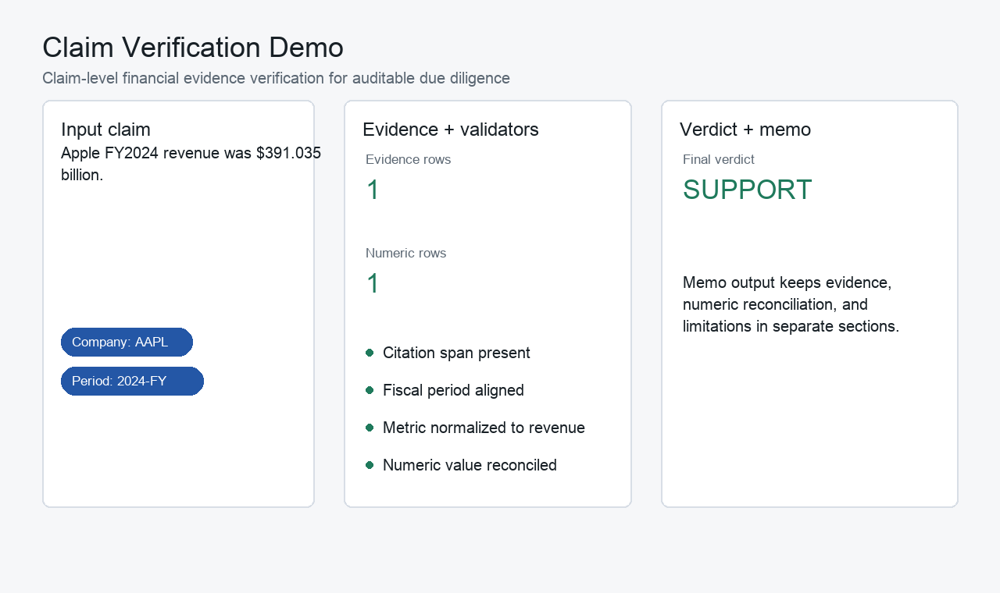
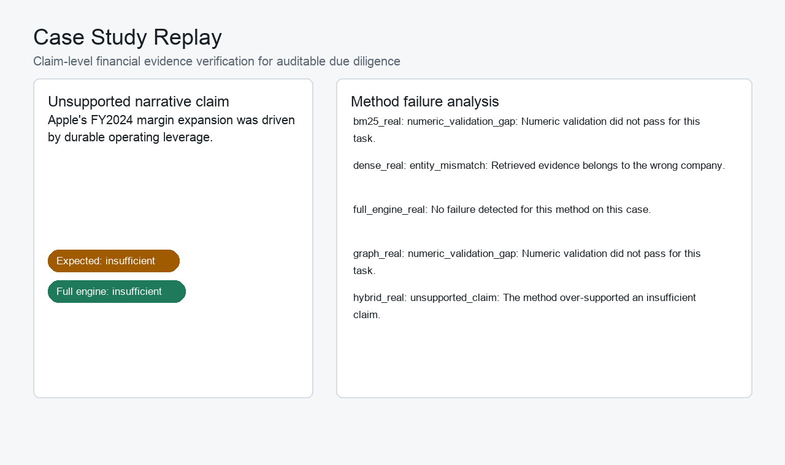
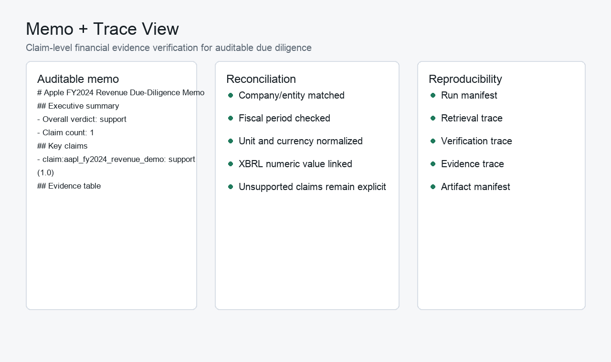

# Financial Evidence Engine

Claim-level financial evidence verification for auditable due diligence: decompose a claim, retrieve evidence, reconcile the numbers, and gate the verdict before writing a memo.

Ordinary retrieval can return plausible but unauditable support. This engine records a `support`, `contradict`, or `insufficient` verdict only after citation, fiscal-period, entity, and numeric checks.

## Results

Headline figures below are the published verdict metrics. Exact ratios are copied from `reports/final_report.md` and `reports/adversarial/phase15_adversarial_report.md`.

| Result | Value | Setup |
| --- | ---: | --- |
| Full-engine verdict accuracy | 83.3% | 60 local due-diligence tasks over a constructed 320-document benchmark corpus (gold evidence specs plus known distractors). Exact ratio `0.8333333333333333333333333333`. Validator-augmented retrieval. |
| BM25 verdict accuracy | 66.7% | Same 60 tasks and 320-document corpus. Exact ratio `0.6666666666666666666666666667`. Retrieval-only BM25. |
| Red-team detection | 75.0% | 120 adversarial tasks across 12 failure modes. Exact full-engine detection accuracy `0.75`. Missed cases stay explainable; that report's explainable failure rate is 1. |

These are research-evaluation numbers on a constructed corpus, not live SEC-scale accuracy. The dense method inside that published comparison is a deterministic token-vector proxy. Separate CPU retrieval runs are below and do not replace this table.

## Architecture

```mermaid
flowchart LR
  claim[Financial claim] --> decompose[Decompose subclaims]
  decompose --> retrieve[Retrieve evidence]
  retrieve --> extract[Text, table, chart, XBRL]
  extract --> normalize[Company, period, unit, currency]
  normalize --> reconcile[Numeric reconciliation]
  reconcile --> graph[Evidence graph]
  graph --> validate[Validator gates]
  validate --> verdict[support, contradict, or insufficient]
  verdict --> memo[Auditable memo]
```

## Quickstart

```bash
python3 -m pip install -e ".[dev]"
PYTHONPATH=src python3 -m financial_evidence_engine.cli verify-claim --claim "Apple FY2024 revenue was $391.035 billion."
make portfolio-demo
```

`make portfolio-demo` expects `screenshots=3`, `commands=6`, `verify_verdict=support`, `docs=6`, and `api_key_required=False`. No API key is required.

## Limitations

- The 60-task benchmark corpus is constructed from gold evidence specifications and known distractors. It is not a broad SEC filing index.
- In that published comparison, dense retrieval is deterministic token-vector cosine search. It is not a neural embedding. Optional API and sentence-transformer backends stay off unless you enable them.
- Retrieval-only methods in the published benchmark emit `support` whenever they retrieve any evidence. That is why BM25 verdict accuracy is 66.7%. The full engine applies validator-style verdict rules to reach 83.3%.
- Red-team detection is 75.0% on 120 constructed adversarial tasks. The misses are labeled, not hidden.
- Investor-deck chart extraction is a narrow text-extractable fixture.
- Do not compare companies, fiscal periods, currencies, or units unless those fields have been normalized.
- The CPU experiments below measure evidence retrieval. They are not verdict accuracy, and they do not change the headline table.

## CPU retrieval experiments

Both runs use the same 60-task, 320-document benchmark corpus. Every retrieved row is marked cited, so citation exactness equals evidence recall. Recall@5 can sit near the ceiling because each task has a handful of gold rows and `top_k` is 5. Full tables, setup, and rerank deltas:

- [TF-IDF SVD ablation](reports/dense_lsa/dense_lsa_rerank_ablation.md)
- [MiniLM ablation](reports/dense_sentence_transformer/dense_sentence_transformer_rerank_ablation.md)

### TF-IDF SVD dense baseline

Setup: sublinear TF-IDF fit on benchmark document text only, then 15 steps of pure-Python subspace iteration toward a 32-dimensional singular subspace (`corpus-tfidf-svd-subspace-v1`, vocabulary 201, `min_df` 2). No BLAS and no neural model. The existing hash-bucket dense proxy (`deterministic-token-v1`, dimension 64) is included as a reference. Metadata rerank is the repository's `MetadataBoostReranker` on a pool of up to 30 candidates.

| Method | Evidence recall@5 | Evidence recall@1 | Entity correctness |
| --- | --- | --- | --- |
| BM25 | 199/200 = `0.995` | 60/200 = `0.3` | `0.9666666666666666666666666667` |
| BM25 + metadata rerank | 199/200 = `0.995` | 60/200 = `0.3` | `0.9666666666666666666666666667` |
| Hash dense proxy | 184/200 = `0.92` | 60/200 = `0.3` | `0.7766666666666666666666666667` |
| TF-IDF SVD | 200/200 = `1` | 60/200 = `0.3` | `0.8033333333333333333333333333` |
| TF-IDF SVD + metadata rerank | 200/200 = `1` | 60/200 = `0.3` | `0.8066666666666666666666666667` |

On this corpus the metadata reranker does not change BM25 recall or BM25 entity correctness. It also does not change TF-IDF SVD recall. SVD entity correctness moves by `0.0033333333333333333333333334`. Reproduce with:

```bash
python3 scripts/run_dense_lsa_experiment.py --config configs/dense_lsa.yaml
```

### MiniLM dense baseline and rerank ablation

Setup: `sentence-transformers/all-MiniLM-L6-v2`, sentence-transformers `6.2.0`, torch `2.15.0+cpu`, device `cpu`, `normalize_embeddings=True`, cosine retrieval, `top_k` 5, metadata rerank on up to 30 candidates. Weights were downloaded at run time and are not in the repository. This is a pretrained encoder, not a model trained for this benchmark.

| Method | Evidence recall@5 | Evidence recall@1 | Entity correctness |
| --- | --- | --- | --- |
| BM25 | 199/200 = `0.995` | 60/200 = `0.3` | `0.9666666666666666666666666667` |
| BM25 + metadata rerank | 199/200 = `0.995` | 60/200 = `0.3` | `0.9666666666666666666666666667` |
| MiniLM | 192/200 = `0.96` | 50/200 = `0.25` | `0.93` |
| MiniLM + metadata rerank | 200/200 = `1` | 60/200 = `0.3` | `0.9733333333333333333333333333` |

Metadata rerank does not move the BM25 ratios. On MiniLM it raises evidence recall@5 by `0.04` (192/200 to 200/200) and evidence recall@1 by `0.05` (50/200 to 60/200). Entity correctness moves by `0.0433333333333333333333333333`.

CPU reproduction:

```bash
python3 -m pip install torch --index-url https://download.pytorch.org/whl/cpu
python3 -m pip install "sentence-transformers==6.2.0"
FINANCIAL_EVIDENCE_ENABLE_LOCAL_EMBEDDINGS=1 python3 scripts/run_sentence_transformer_baseline.py --config configs/dense_sentence_transformer.yaml
```

Without that environment variable the script leaves the checked-in artifact in place and prints `not yet run`.

## Reproduction

### 2-minute read

- [Interview story](docs/interview_story.md)
- [60-second pitch](docs/sixty_second_pitch.md)
- [Resume bullets](docs/resume_bullets.md)
- [Failure modes](docs/failure_modes.md)
- [Portfolio entry](PORTFOLIO.md)

### 10-minute artifact

- [Portfolio report PDF](reports/final_report.pdf)
- [Portfolio report Markdown](reports/final_report.md)
- [Demo script](docs/demo_script.md)

### 30-minute reproduction

```bash
python3 -m pytest
python3 scripts/run_dense_lsa_experiment.py --config configs/dense_lsa.yaml
python3 scripts/build_portfolio_screenshots.py
python3 scripts/smoke_trace_reproducibility.py
python3 scripts/build_portfolio_report.py
python3 scripts/smoke_demo_ui.py
python3 scripts/smoke_cli_workflow.py
python3 scripts/smoke_interview_packaging.py
```

Validation commands for the individual smoke checks are listed in `VALIDATION.md`.

## Demo

| Claim verification | Case-study replay | Memo and trace view |
| --- | --- | --- |
|  |  |  |

```bash
python3 -m streamlit run app.py
```

## License

MIT. Copyright (c) 2026 Orrin Chen. See [LICENSE](LICENSE).
